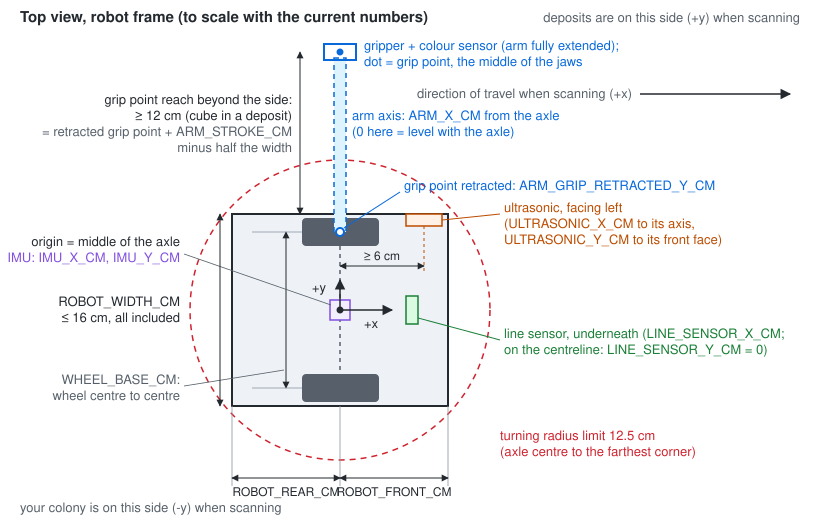

# Robot design numbers: from the CAD to the code

The robot's software is built on one file: [`include/robot_design.h`](../include/robot_design.h).
It holds every dimension the code needs from the mechanical design: the body size, the wheels, the
arm and where each sensor sits. The firmware reads these numbers directly. For example, the arm
uses `ARM_STROKE_CM` to know how far it can extend, and the navigation uses `ARM_X_CM` to know
where to stop in front of a cube.

**You own that file.** When the CAD changes, change the numbers there. An automatic check then
tells you within a few minutes whether the design still meets every competition limit, and if
not, which limit, by how much and what to change.

## 1. Where each number is measured



- **Origin:** the middle of the wheel axle, seen from above.
- **+x:** forward, towards the end with the line sensor. The robot scans for cubes while moving this way.
- **+y:** to the robot's **left**. The ultrasonic and the arm are on this side, and it faces the deposits while scanning.
- **Units:** cm.
- **"Everything included":** width, front and rear are the outer limits of everything: wheels, retracted arm, gripper, sensors, cables, screw heads.

| Number in `robot_design.h` | What to measure | Limit |
| --- | --- | --- |
| `ROBOT_WIDTH_CM` | Left-most to right-most point | ≤ 16 cm |
| `ROBOT_FRONT_CM` | Axle → front-most point | Turning radius (below) |
| `ROBOT_REAR_CM` | Axle → rear-most point | Turning radius (below) |
| `WHEEL_DIAMETER_CM` | Drive wheel outer diameter | Inside the body |
| `WHEEL_BASE_CM` | Centre of one wheel's tread → centre of the other | < width |
| `LINE_SENSOR_X_CM` | Axle → middle of the line follower's two sensors | Ahead of the axle, inside the body |
| `LINE_SENSOR_Y_CM` | Centreline → middle of the line follower | 0 (± 0.5 cm) |
| `ULTRASONIC_X_CM` | Axle → ultrasonic axis (the centre between its two "eyes") | ≥ 6 cm ahead of the arm axis |
| `ULTRASONIC_Y_CM` | Centreline → ultrasonic front face | Left side, inside the body |
| `ARM_X_CM` | Axle → arm axis (the line the rack slides along); negative = behind the axle | See section 2 |
| `ARM_GRIP_RETRACTED_Y_CM` | Centreline → **grip point** with the arm fully retracted | Inside the body |
| `ARM_STROKE_CM` | Rack travel, fully retracted → fully extended | Reach (below) |
| `IMU_X_CM`, `IMU_Y_CM` | Axle centre → MPU-6050 chip | Inside the body, as close to the axle centre as you can |

The **grip point** is the middle of the gripper jaws: where the centre of the cube sits when the
gripper holds it.

## 2. The rules, and why they exist

These are checked automatically by `test/test_robot_design`. The track numbers come from the rules
(CDC) and the printed mat.

**Width ≤ 16 cm.** The colony line runs in a corridor about 20 cm wide: about 10 cm to the deposit
lines on one side and 10 cm to the construction zones on the other. Touching a deposit line counts as
being inside the deposit, and both sides of the robot face the deposits on some trips.

**Turning radius ≤ 12.5 cm.** The robot spins 180° on the spot in the 15 cm gap between two
deposits, at 10 cm from the deposit lines. The farthest corner sweeps a circle of radius $R$:

$$
R = \sqrt{\left(\frac{W}{2}\right)^2 + L^2} \;\le\; \sqrt{g^2 + \left(\frac{s_\text{gap}}{2}\right)^2} = \sqrt{10^2 + 7.5^2} = 12.5\ \text{cm}
$$

where $W$ is the width and $L$ is the larger of front and rear. So, at a given width, front and rear
are each limited to:

$$
L \le \sqrt{R^2 - \left(\frac{W}{2}\right)^2}, \qquad \text{at } W = 16: \quad L \le \sqrt{12.5^2 - 8^2} \approx 9.6\ \text{cm}
$$

**Ultrasonic at least 6 cm ahead of the arm.** When the echo of a cube ends, the arm must not have
passed the cube yet, so the robot only drives forward to line the arm up and never reverses.

**Arm reach.** The cube in the middle of a deposit is 20 cm from the colony line, and a zone centre
is 17.5 cm from it. The grip point must get that far beyond the robot's side:

$$
\text{reach} = y_\text{grip, retracted} + \text{stroke} - \frac{W}{2} \;\ge\; 20 - \frac{W}{2}
$$

(12 cm at W = 16 cm).

**Arm position along the robot (`ARM_X_CM`).** The robot centre must stay at least $R + 3$ cm from
each end of the territory, so the robot centre travels along x from about 15 to 115 cm. The robot
stops with the arm level with each zone and each cube, so if the arm is far from the axle, the end
zones (observation at x = 20, recycling at x = 110) can't be reached. With the current numbers,
`ARM_X_CM` may be about −5 to +1 cm. The upper limit comes from the ultrasonic rule above. The
design report prints the exact range for your current numbers.

**Not checked automatically, but needed:**
- **IMU:** flat, x-axis pointing forward, rigidly mounted (no foam, no wobble).
- **Gripper weight:** the gripper sits at the tip of the arm. Check that the fully extended rack doesn't sag.
- **Parts:** the rules (CDC §3.6) allow only kit parts, the AFIS colour sensor and AA cells. No external structural part unless AFIS agrees in writing. Keep that agreement for the dossier.

## 3. How to update the numbers (on the GitHub website, nothing to install)

1. Open the repository on GitHub and click `include` → `robot_design.h`.
2. Click the **pencil icon** (Edit this file) at the top right of the file.
3. Change **only the numbers**. Keep the `f` and the `;`: `16.0f;` → `15.5f;`.
4. Click **Commit changes…**. In the message, say what changed (e.g. "CAD v3: arm moved 1 cm back"), then click **Commit changes**.
5. Wait 2–3 minutes and look at the commit. A yellow dot means the check is running, ✅ means the design passes, ❌ means a rule failed. GitHub also emails you when a check fails.
6. On ❌: click it → **Details** → open the step **"Robot design check and PC unit tests"**. Lines ending in `[FAILED]` tell you what to change, for example:

   ```
   test_turning_radius_within_limit: turning radius is 13.45 cm, limit 12.50 cm (180-degree turn
   between two deposits): at 20.0 cm width, ROBOT_FRONT_CM and ROBOT_REAR_CM must each be <= 7.50 cm
   ```

7. Even when everything passes, the same step prints a **DESIGN REPORT**. It shows how much room is left on each limit (turning radius, arm reach, allowed arm position), which is useful while you are still designing.

You can also try numbers without changing the real design: edit the file, then choose **"Create a new
branch… and start a pull request"** instead of committing to `main`. The check runs on the pull
request, and you can close it if you don't want to keep the change.
